# Road Accident Analysis — SQL and Dashboard Analysis of Road Casualties (2021–2022)

> Comparative analysis of road casualties and accidents between 2021 and 2022, developed with SQL Server and presented in Excel, Power BI, and Tableau dashboards.

---

## Table of Contents
1. [Executive Summary](#executive-summary)
2. [Business Storytelling (SCQA)](#business-storytelling-scqa)
3. [Project Objectives](#project-objectives)
4. [Tech Stack](#tech-stack)
5. [Dataset](#dataset)
6. [Project Workflow](#project-workflow)
7. [Repository Structure](#repository-structure)
8. [SQL Server Analysis](#sql-server-analysis)
9. [Dashboard Preview](#dashboard-preview)
10. [Key Insights (C→F→I)](#key-insights-cfi)
11. [Business Recommendations](#business-recommendations)
12. [How to Reproduce](#how-to-reproduce)
13. [Limitations and Data Quality Notes](#limitations-and-data-quality-notes)
14. [Future Improvements](#future-improvements)
15. [Author](#author)
16. [Usage Notice](#usage-notice)

---

## Executive Summary

- **Problem:** understand how road casualties and accidents evolved between 2021 and 2022, and in which contexts (vehicle type, road type, area, light, surface, city) they are concentrated.
- **What was built:** 10 SQL Server queries and 3 equivalent dashboards (Excel, Power BI, and Tableau) covering the same analysis period.
- **Main result:** casualties dropped from **222,146 (2021)** to **195,737 (2022)**, a **11.89%** decrease; recorded accidents fell **11.70%** (163,554 → 144,419).
- **Value:** an executive dashboard that helps prioritize road safety actions by context and severity.

---

## Business Storytelling (SCQA)

- **S (Situation):** **417,883 casualties** linked to **307,973 accidents** recorded in 2021 and 2022 are analyzed.
- **C (Complication):** although the total fell 11.89%, the reduction is not uniform: some contexts declined less (e.g., rural area −14.91% vs. urban −9.93%) and some cities increased (Cornwall +21.06%, County Durham +7.62%, Liverpool +5.16%).
- **Q (Question):** where are casualties concentrated, and in which contexts should intervention start?
- **A (Answer):** risk is concentrated in **cars (79.8%)**, **single carriageways (74.1%)**, **urban areas (61.2%)**, and **daytime (73.0%)**; severity is mostly slight (84.1%), with 1.7% fatal cases.

---

## Project Objectives

### General Objective
Analyze the evolution of road casualties and accidents in 2021–2022 and communicate the results through decision-oriented dashboards.

### Specific Objectives
- Calculate total KPIs and year-over-year (YoY) change with SQL Server.
- Segment casualties by severity, vehicle type, road type, area, light, and surface conditions.
- Identify the Top 10 local authorities with the most casualties.
- Replicate the same analysis in Excel, Power BI, and Tableau.

---

## Tech Stack

- SQL Server (CTEs, window functions, conditional aggregation)
- Excel (pivot tables and dashboard)
- Power BI
- Tableau
- Git and Git Bash (version control)
- GitHub

> This project does not use Python, so it does not include a `requirements.txt` file.

---

## Dataset

| Attribute | Description |
|---|---|
| Source | Practice dataset of UK road accidents (British local authorities) |
| Records analyzed | 307,973 accidents (rows) |
| Time Period | 01-Jan-2021 to 31-Dec-2022 |
| Granularity | One record per vehicle/accident (`Accident_Index` identifies the accident) |
| Main metric | `Number_of_Casualties` |
| Analysis fields | severity, vehicle type, road type, urban/rural area, light conditions, surface, local authority, date |

> The raw Tableau file also contains 2019–2020; the analysis is scoped to 2021–2022 (current year vs. previous year).
>
> Two versions of the data are published according to their use: `data/processed/road_accident_clean_excel.xlsx` (basis for Excel, SQL Server, and Power BI) and `data/raw/road_accident_raw_tableau.csv` (basis for the Tableau dashboard). They differ in the 2021 severity classification (see [Limitations](#limitations-and-data-quality-notes)).

---

## Project Workflow

```text
Raw Data → Cleaning (Excel) → SQL Server Analysis → Dashboards (Excel / Power BI / Tableau) → Insights → Recommendations
```

---

## Repository Structure

```text
road_accident_analysis/
├── dashboards/
│   ├── excel/        # Excel dashboard
│   └── power_bi/     # Power BI dashboard (.pbix)
├── data/
│   ├── raw/          # Original data for Tableau (CSV)
│   └── processed/    # Clean data (Excel) used in Excel, SQL, and Power BI
├── images/
│   ├── excel/        # Data and dashboard screenshots (Excel)
│   ├── power-bi/     # Dashboard screenshot
│   ├── sql/          # Results of the 10 queries
│   ├── tableau/      # Screenshots by severity
│   ├── to_create_dashboards_power_bi/   # Design assets (backgrounds and icons)
│   └── to_create_dashboards_tableau/    # Design assets (backgrounds)
├── sql/
│   └── road_accident_analysis.sql
├── README.md
└── .gitignore
```

> The `to_create_dashboards_*` folders contain only the backgrounds and icons used to design the dashboards; they are not part of the analysis.

---

## SQL Server Analysis

The script [`sql/road_accident_analysis.sql`](sql/road_accident_analysis.sql) contains 10 queries. All of them compare the previous year (PY = 2021) against the current year (CY = 2022) using conditional aggregation, and use `NULLIF` to avoid division by zero.

| # | Query | Key result |
|---|---|---|
| 01 | Total casualties | 417,883 (2021: 222,146 · 2022: 195,737 · YoY −11.89%) |
| 02 | Total accidents | 307,973 (2021: 163,554 · 2022: 144,419 · YoY −11.70%) |
| 03 | Casualties by severity | Slight 84.1%, serious 14.2%, fatal 1.7% |
| 04 | Casualties by vehicle type | Car 333,485 (79.8%) |
| 05 | Casualties by month | Largest drops: December (−28.94%) and January (−27.57%); February +1.06% |
| 06 | Casualties by road type | Single carriageway 309,698 (74.1%) |
| 07 | Casualties by area | Urban 61.2% · Rural 38.8% |
| 08 | Casualties by light condition | Day 73.0% · Night 27.0% |
| 09 | Casualties by road surface condition | Dry 66.9% |
| 10 | Top 10 local authorities | Birmingham leads (8,611) |

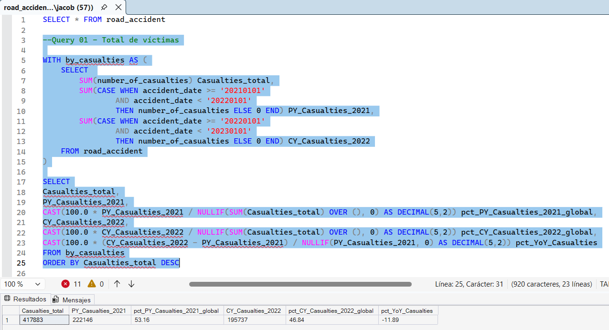

*Query 01 — Total casualties and YoY change*

---

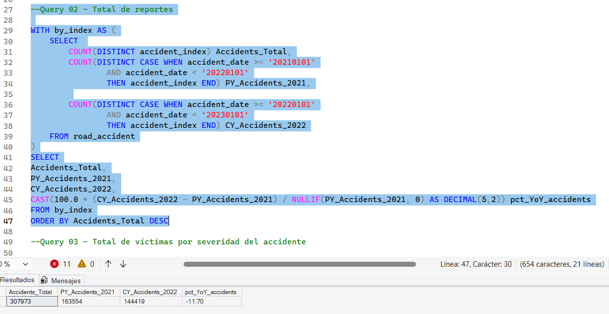

*Query 02 — Total accidents*

---

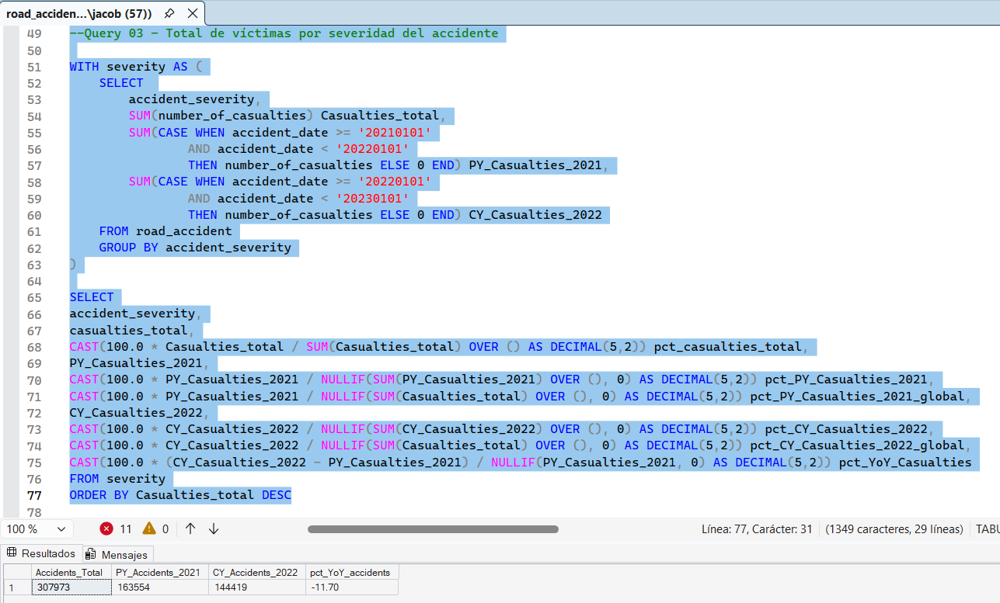

*Query 03 — Casualties by accident severity*

---

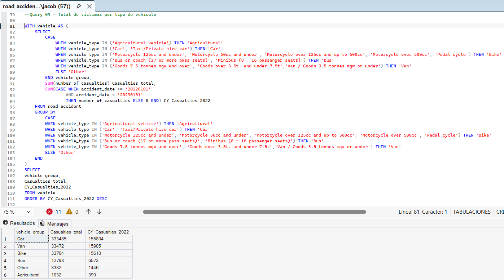

*Query 04 — Casualties by vehicle type*

---

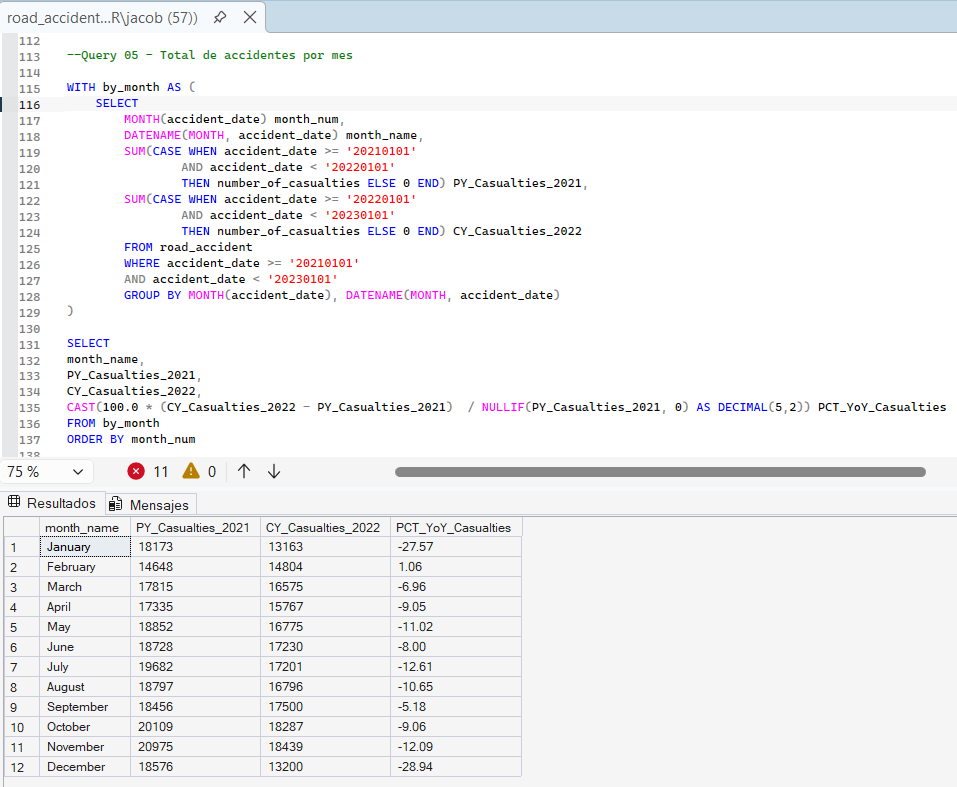

*Query 05 — Casualties by month (2021 vs. 2022)*

---

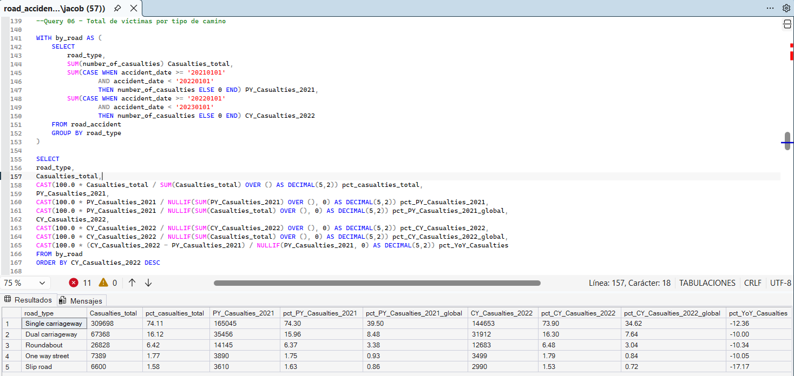

*Query 06 — Casualties by road type*

---

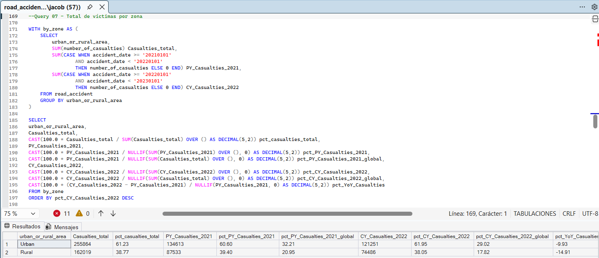

*Query 07 — Casualties by area (urban/rural)*

---

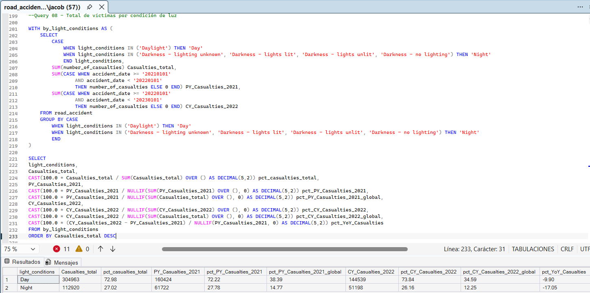

*Query 08 — Casualties by light condition*

---

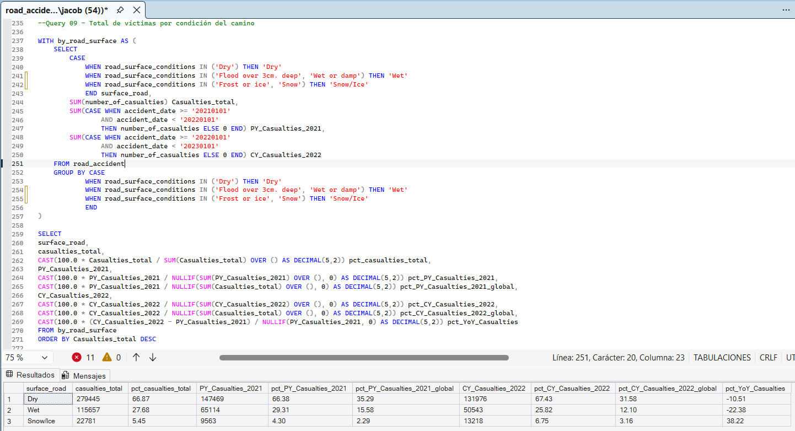

*Query 09 — Casualties by road surface condition*

---

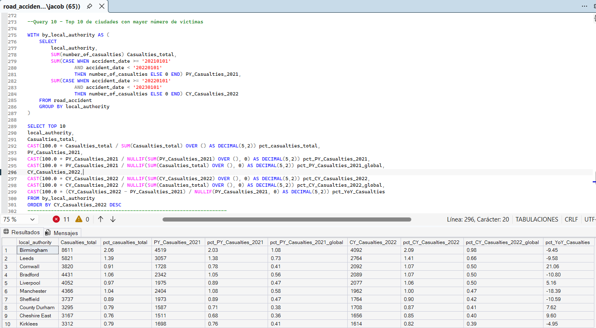

*Query 10 — Top 10 local authorities by casualties*

---

## Dashboard Preview

### Excel

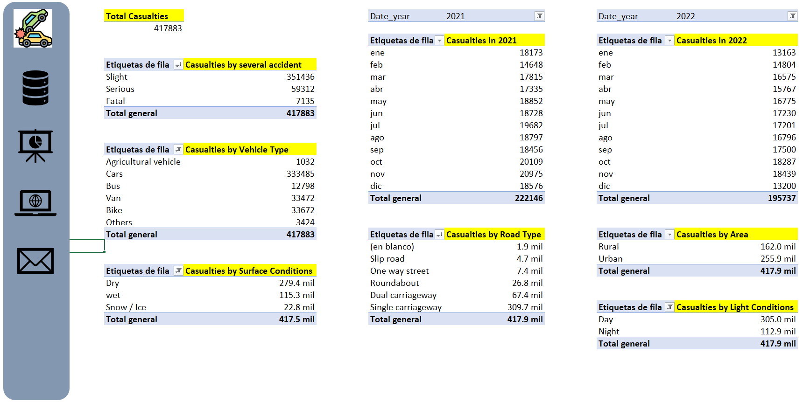

*Supporting pivot tables*

---

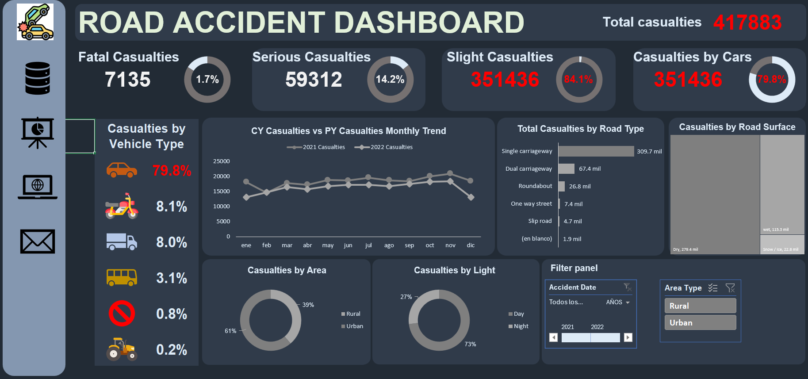

*Excel dashboard*

### Power BI

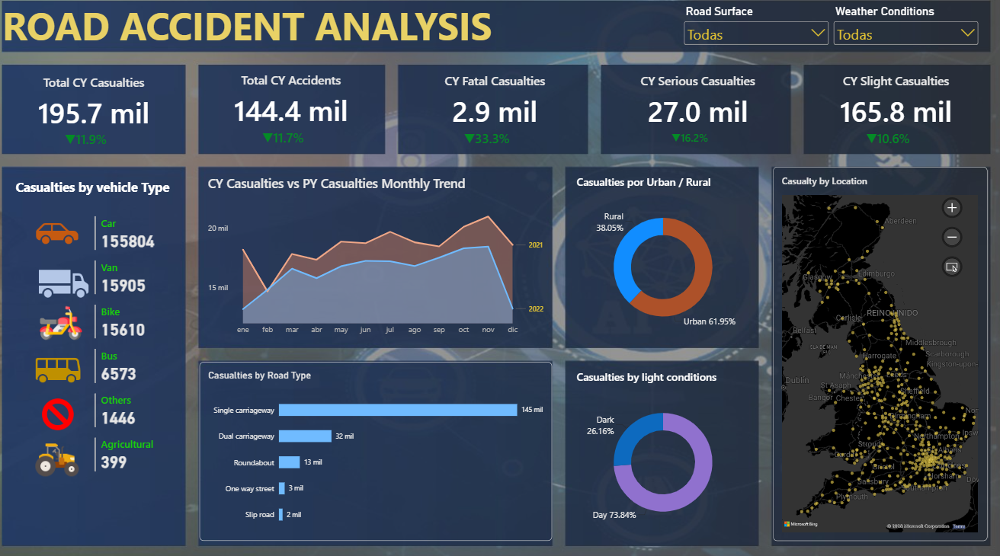

*Power BI dashboard (current vs. previous year, location map, road surface and weather filters)*

### Tableau

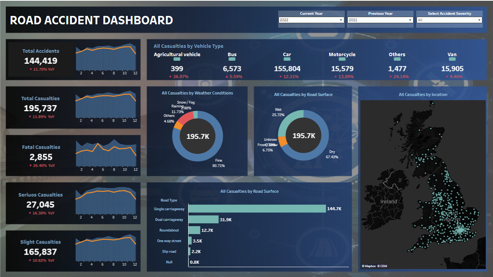

*Overview (all severities)*

---

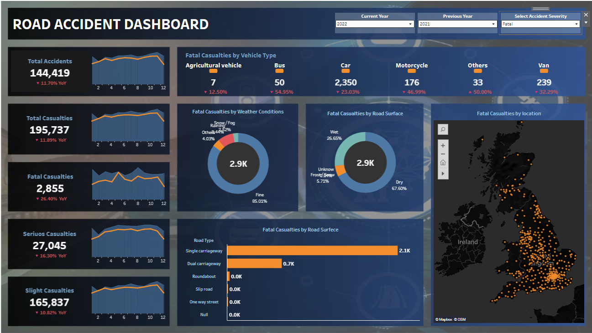

*Filter: fatal severity*

---

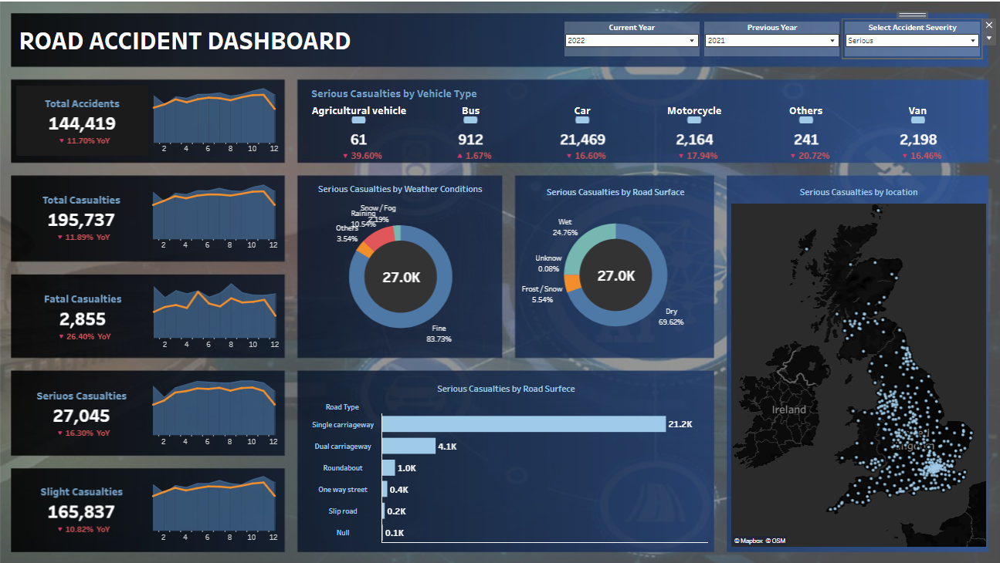

*Filter: serious severity*

---

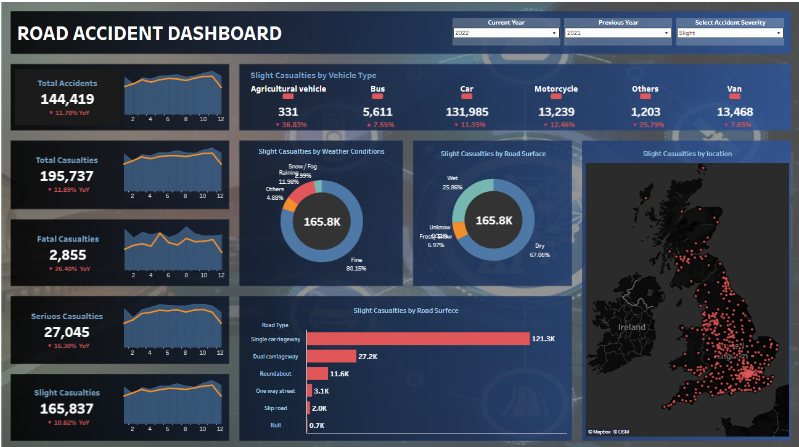

*Filter: slight severity*

---

## Key Insights (C→F→I)

### Insight 1 — Overall reduction
- **Cause:** comparison of 2022 vs. 2021, national total.
- **Finding:** casualties −11.89% (222,146 → 195,737) and accidents −11.70%.
- **Impact / Recommended Action:** keep current measures in place and monitor monthly to confirm the trend holds; February (+1.06%) was the only month without a reduction.

### Insight 2 — Concentration by vehicle and road type
- **Cause:** cumulative 2021–2022.
- **Finding:** cars account for 79.8% of casualties and single carriageways for 74.1%.
- **Impact / Recommended Action:** prioritize campaigns and infrastructure review on single carriageways, where the highest volume is concentrated.

### Insight 3 — Urban–rural gap
- **Cause:** cumulative 2021–2022.
- **Finding:** urban areas account for 61.2% of casualties, but rural areas improved more in 2022 (−14.91% vs. −9.93%).
- **Impact / Recommended Action:** strengthen actions in urban settings, where the reduction was smaller.

### Insight 4 — Night and city contrasts
- **Cause:** 2022 vs. 2021.
- **Finding:** nighttime accounts for 27.0% of casualties even though it fell −17.05%; among the 10 cities with the most casualties, Cornwall (+21.06%), County Durham (+7.62%), Cheshire East (+9.60%), and Liverpool (+5.16%) increased.
- **Impact / Recommended Action:** focus safety audits on the local authorities with a year-over-year increase.

---

## Business Recommendations

- Concentrate prevention on passenger vehicles and single carriageways.
- Strengthen urban management and signage/lighting for night-time stretches.
- Give priority follow-up to the local authorities whose casualties increased in 2022.
- Monitor YoY change monthly to detect deviations early.

---

## How to Reproduce

1. Clone the repository.
2. Load `data/processed/road_accident_clean_excel.xlsx` into a SQL Server database (table `road_accident`).
3. Run the queries in `sql/road_accident_analysis.sql`.
4. Open the Excel dashboard in `dashboards/excel/`.
5. Open the Power BI report in `dashboards/power_bi/`.
6. For Tableau, connect `data/raw/road_accident_raw_tableau.csv`.

---

## Limitations and Data Quality Notes

- The analysis is descriptive; it does not establish causality and is not normalized by exposure (distance traveled, vehicle fleet).
- Vehicle type grouping differs between tools: in SQL and Power BI, "Bike" includes bicycles (*pedal cycle*); in Tableau, "Motorcycle" does not.
- Two versions of the source file were used. Excel, SQL Server, and Power BI use the clean Excel base (2021 fatal casualties: 4,280; fatal YoY −33.3%), while Tableau uses its own CSV (2021 fatal casualties: 3,879; fatal YoY −26.4%). Total casualties and accidents match across all four tools; the difference lies in the 2021 severity classification (2022 is identical).

---

## Future Improvements

- Normalize rates by population or exposure.
- Automate data loading and refresh.
- Add analysis by time of day and speed limit.

---

## Author

**Jacobo Galindo Ortiz**
Data Analyst Portfolio

[](https://www.linkedin.com/in/jacobo-galindo-ortiz)
[](https://github.com/JacoboGO)
[](https://public.tableau.com/app/profile/jacobo.galindo.ortiz/vizzes)
[](mailto:jacobo.galindo.ortiz@hotmail.com)

---

> *"Language is a window into the mind."*
> — Noam Chomsky

<div align="center">

⭐ If this project was useful to you, consider leaving a star
on the repository — it helps a lot and is greatly appreciated.

</div>

---

## Usage Notice

This repository is provided for portfolio and educational review purposes.

The project may be viewed to evaluate the analytical approach,
methodology, and implementation. It is not intended for redistribution,
commercial use, or incorporation into other projects without prior
written permission from the author.

If you would like to reference or discuss any part of this work,
please contact the author.
